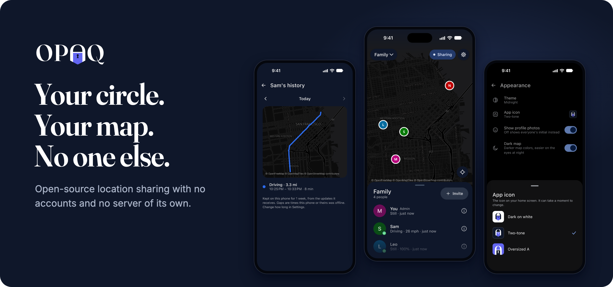
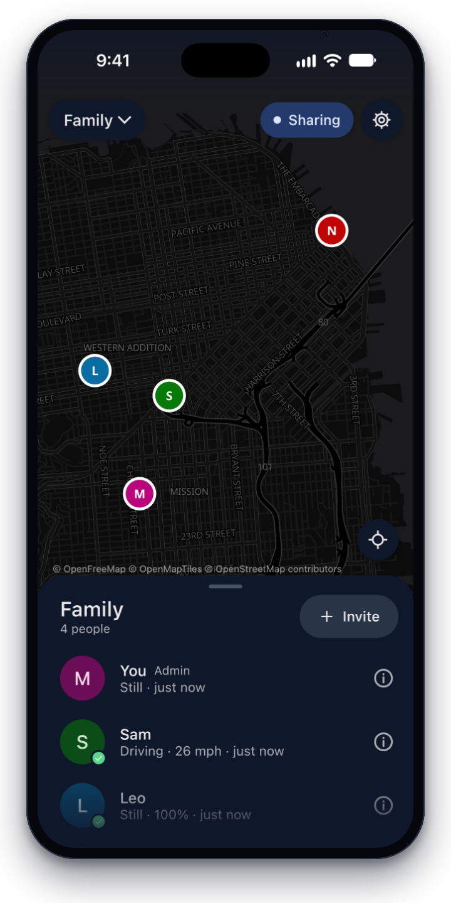
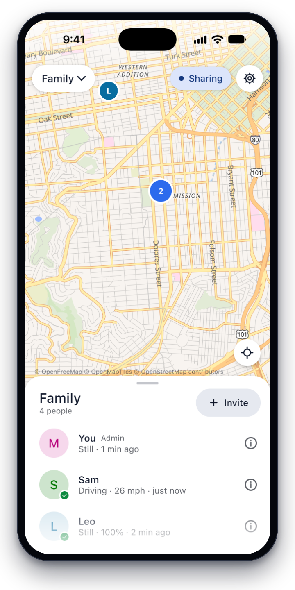
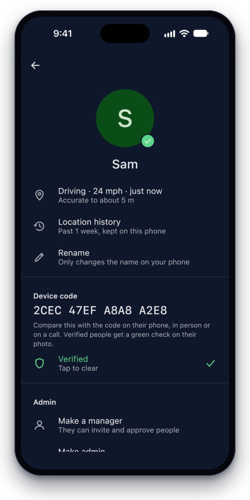
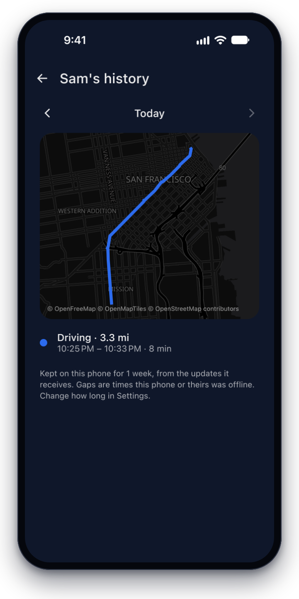
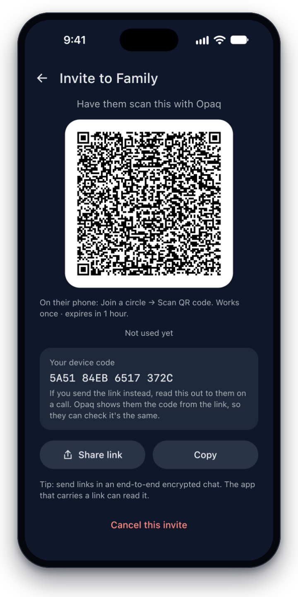
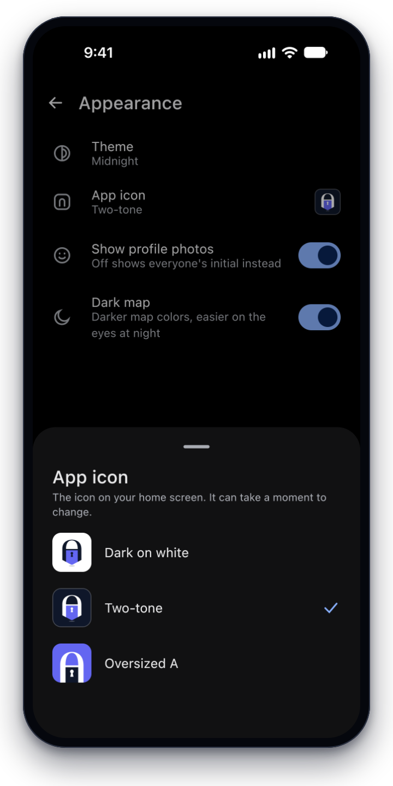

<p align="center">
  <picture>
    <source media="(prefers-color-scheme: dark)" srcset="docs/readme/wordmark-dark.svg">
    
  </picture>
</p>

<p align="center">
  <strong>Private location sharing with the people you choose.</strong><br>
  No accounts, no phone numbers, and no Opaq server.
</p>

<p align="center">
  <a href="LICENSE"></a>
  
  
  
</p>

<p align="center">
  <a href="https://opaq.me"><strong>opaq.me</strong></a>&emsp;
  <a href="PRIVACY.md">Privacy details</a>&emsp;
  <a href="TESTING.md">Testing</a>&emsp;
  <a href="https://opaq.me/report">Report a problem</a>
</p>

<p align="center">
  
</p>

## Why Opaq

- **Identity is a key on your phone.** On first launch the app creates a secp256k1 keypair. Your *device code* (for example `7F3A 91C2 D04E 6B1A`) is a fingerprint of the public key; compare it in person to verify someone.
- **Circles share both ways**, like other 360-type apps. The circle admin sends a signed invite link that expires in an hour (or 24 hours), and approves each person who opens it.
- **Everything is end-to-end encrypted** on the device before it leaves. Updates travel through public [Nostr](https://nostr.com) relays, which only ever see ciphertext.
- **Open source.** Anyone can check what the app sends.

Runs on Android 8.0+ and iOS 17+ (iPhone and iPad) from one shared Kotlin Multiplatform codebase. Still in early development.

## A look around

<table>
  <tr>
    <td align="center" width="33%"><br><sub><b>Your circle on the map</b><br>Everyone as a dot, with what they're doing</sub></td>
    <td align="center" width="33%"><br><sub><b>Light, Dark or Midnight</b><br>Follows your phone, or pick a theme</sub></td>
    <td align="center" width="33%"><br><sub><b>Profiles</b><br>Status, history and the device code to compare</sub></td>
  </tr>
  <tr>
    <td align="center"><br><sub><b>Location history</b><br>Kept encrypted on the phone, never uploaded</sub></td>
    <td align="center"><br><sub><b>Invites</b><br>A QR code or a link, and every join is approved</sub></td>
    <td align="center"><br><sub><b>Your icon</b><br>Dark on white, Two-tone or Oversized A (shown in Midnight)</sub></td>
  </tr>
</table>

<sub>Screenshots come from the iOS simulator, with test people and locations.</sub>

## Features

- **Live map.** Everyone in the circle as a dot with their photo or colour, plus a people list with what they're doing ("Walking", "Driving", "Still") and battery level if they share it. Tap a dot or a row to open their profile.
- **Smooth movement.** Between updates, a moving person's dot carries on along the road they're on, so it doesn't jump every 30 seconds. This is worked out on your phone; nothing extra is sent.
- **Location history.** Each phone keeps the updates it receives in encrypted files on the device (7 days by default, up to 90, or off). Open it from a profile to see the day's path and stops.
- **Circles.** Invite with a link or QR code, scan codes in the app, let a link be used by up to 10 people, and approve every join. Make people managers, hand over the admin role, rename, remove someone (which changes the key), or delete the circle.
- **Verification.** Compare device codes, or scan the QR in person; verified contacts get a green check.
- **Your phone, your keys.** Optional PIN, a security log of PIN changes, lockouts and backups, and a passphrase-encrypted backup file (Argon2id) you can restore on a new phone.
- **Privacy options.** Connect through Tor (with Orbot), choose your own relays, hide the app in recent apps, turn off profile photos or battery sharing.
- **Every screen size.** Phones get a draggable people sheet under the map. Turned sideways, on an unfolded foldable or on a tablet, the people list moves to a side panel you can collapse. Light and dark themes, with an optional dark map.

## How it works

| Piece | What it does |
|---|---|
| Location updates | Encrypted once per circle (NIP-44 v2 with a circle key that ratchets forward daily and is replaced weekly), padded to a fixed size, and published as a replaceable Nostr event. Relays keep only the newest one. |
| Unlinkability | The signing key and the event tag both change every hour, and come from secrets the relay doesn't have, so relays can't tie a member's updates together across hours. Each update is also signed inside the encryption by the sender's real key, so circle members know who sent it. |
| Send rhythm | Two fixed rates with jitter: about every 30 seconds while moving, about every five minutes while still. Relays can tell at most whether someone is moving. Walking, driving and speed are inside the encryption. |
| Invites and approvals | Sealed one-to-one messages (kind 1059) signed by a throwaway key and encrypted to the recipient. |
| Removing someone | The admin rotates the circle key and sends it only to remaining members. |
| Storage | App state, including your private key, is encrypted with an Android Keystore key (iOS: the Keychain) and excluded from cloud and device backups. Location history uses its own key that never leaves the phone. |
| Map | MapLibre (via maplibre-compose, on Android and iOS) with OpenFreeMap tiles. The tile server sees roughly which area you're viewing, never anyone's position. |

## Project layout

```
shared/       Kotlin Multiplatform core: crypto, Nostr, circles, invites, motion policy (+ unit tests)
ui/           Compose Multiplatform screens and map, shared by Android and iOS
androidApp/   Android app: foreground location service, Keystore storage, permissions
iosApp/       Xcode project for the iPhone and iPad app (iOS code lives in ui/src/iosMain)
site/         opaq.me on GitHub Pages: the website, the invite link page and the report form
docs/readme/  Images for this README (screenshots from the iOS simulator, with test data)
```

## Building

Requires JDK 17 and the Android SDK (Android Studio installs both).

```
./gradlew :shared:testAndroidHostTest    # crypto and protocol tests
./gradlew :androidApp:assembleDebug      # debug APK in androidApp/build/outputs/apk/debug/
```

Every push runs the tests and compiles the app on GitHub Actions. Merges to `main` also build the debug and staging APKs, attached to the run as `opaq-debug-apk` and `opaq-staging-apk`, and run a smoke test on an emulator. To get APKs from another branch, run the workflow by hand from the Actions tab.

See [TESTING.md](TESTING.md) for how to test on real phones.

## Licence

Opaq's code is released under the [MIT licence](LICENSE). Copyright © 2026 Carter Keel.

The licence covers the code. The Opaq name and logo aren't part of it, so a fork should use its own name and icon.
